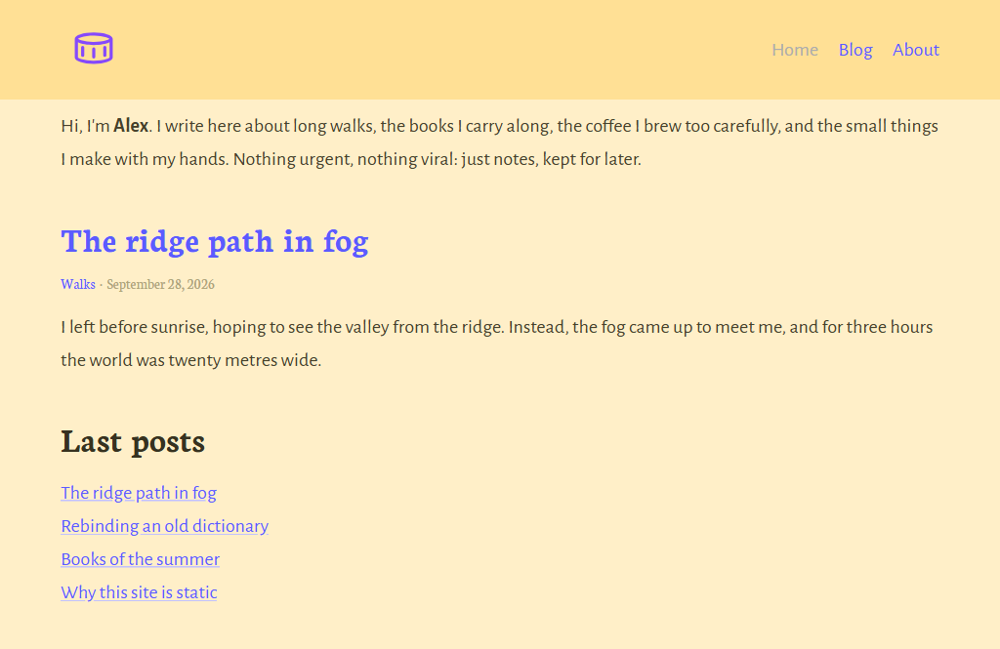

# Garth theme

_Garth_ is a modern, clean, and responsive theme for [Cecil](https://cecil.app). It is a port of the [Garth](https://github.com/daviddarnes/garth) theme for Jekyll created by [David Darnes](https://github.com/daviddarnes).



## Installation

```bash
composer require cecil/theme-garth
```

> Or [download the latest archive](https://github.com/Cecilapp/theme-garth/releases/latest/) and uncompress its content in `themes/garth`.

## Usage

Add `garth` in the `theme` section of your `config.yml`:

```yaml
theme:
  - garth
```

### Change colors

#### From configuration

```yaml
assets:
  compile:
    variables:
      bodyColour: '#5a5a5a'
      linkColour: '#7E4EA3'
      backgroundColour: '#F1F3F4'
```

#### From files

1. Copy `themes/garth/assets/sass/garth.scss` to `assets/sass/garth.scss`
2. Copy `themes/garth/assets/sass/_colors.scss` to `assets/sass/_colors.scss`
3. Edit colors in `_colors.scss`

## Demo

The [`demo/`](demo/) folder contains a demo website, built and deployed to [GitHub Pages](https://cecilapp.github.io/theme-garth/).

To preview it locally, link the theme in `demo/themes/garth` then run Cecil:

```bash
mkdir -p demo/themes && ln -s ../.. demo/themes/garth
php cecil.phar serve demo
```

> On Windows: `New-Item -ItemType Junction -Path demo/themes/garth -Target (Get-Location).Path`

## License

_Garth_ is a free software distributed under the terms of the MIT license.

© [Arnaud Ligny](https://arnaudligny.fr)
